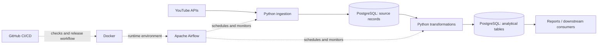

# YouTube Insight

A data engineering project for collecting and analyzing YouTube channel and video data. Its architecture combines API ingestion, Python transformations, Apache Airflow, PostgreSQL, Docker, and GitHub CI/CD.

## Scope

The project is designed to support analysis of:

- Channel and video performance over time.
- Publishing frequency and performance by content group.
- Differences between individual videos and a channel's typical performance.
- Comparable metrics across a selected set of creators, KOCs, or KOLs.

Public channel and video data can be collected within the API's access limits. Metrics such as watch time, impressions, click-through rate, and audience demographics require authorization from the channel owner. Unavailable metrics must remain unavailable in the dataset; they must not be estimated from public view counts.

## System architecture

| Component | Responsibility |
| --- | --- |
| API ingestion | Retrieve channel and video records; handle pagination, quotas, transient failures, and repeated runs. |
| Python transformations | Validate and normalize records, derive metrics, and prepare analytical tables. |
| Apache Airflow | Schedule dependent tasks and record execution status. |
| PostgreSQL | Store source records and transformed data for analysis and traceability. |
| Docker | Provide a consistent runtime for local development and deployment. |
| GitHub CI/CD | Run automated checks and manage the release workflow. |

The diagram shows component boundaries and data flow. It does not specify credentials, infrastructure configuration, or deployment topology.

## Repository architecture

The repository layout groups code by pipeline responsibility. Directory paths are **TBD**.

| Area | Responsibility | Path |
| --- | --- | --- |
| Ingestion | API clients, collection logic, and source record handling. | TBD |
| Transformation | Normalization, metric calculations, and analytical datasets. | TBD |
| Orchestration | Airflow DAGs and task dependencies. | TBD |
| Storage | Database definitions and data access code. | TBD |
| Quality | Data validation and automated tests. | TBD |
| Runtime | Docker configuration and local execution. | TBD |
| Automation | GitHub CI/CD workflows. | TBD |

Module interfaces and directory names: **TBD**.

## Data architecture

| Logical entity | Grain | Purpose |
| --- | --- | --- |
| Channel | One record per channel identifier. | Channel metadata and identity. |
| Video | One record per video identifier. | Video metadata and its channel relationship. |
| Metric snapshot | One record per entity and observation time. | Historical view and engagement values. |
| Pipeline run | One record per ingestion or transformation run. | Traceability and execution checks. |

Physical PostgreSQL schema, retention rules, and indexing strategy: **TBD**.

## Data processing flow

1. **Ingest:** collect records for configured channels and videos. Record the observation time separately from the video publication time.
2. **Store source data:** retain enough source information to trace a derived value back to an API response and ingestion run.
3. **Transform:** normalize identifiers and timestamps, handle missing values, and deduplicate records so a retry does not create duplicate observations.
4. **Build analytical data:** create channel, video, and time-based views or tables from validated source records.
5. **Check quality:** detect incomplete runs, missing identifiers, unexpected changes, and stale data before downstream use.

The logical data model distinguishes channel and video entities from metric snapshots. Snapshot values are cumulative observations at a point in time; a change between snapshots is a separate derived measure.

## Metric conventions

| Metric | Definition | Interpretation note |
| --- | --- | --- |
| Views | View count reported at observation time. | Cumulative value, not views earned on that day. |
| View change | Difference between two valid observations of the same video. | Depends on the observation interval and data availability. |
| Engagement per view | `(likes + comments) / views`, when all inputs are available and views are greater than zero. | Descriptive measure; it is not a measure of watch time or conversion. |
| Data freshness | Time elapsed since the latest successful observation. | Should accompany reports and comparisons. |

Comparisons should use a consistent time window and account for video age and channel size. Missing or hidden values are represented as missing, not zero. Metric definitions and source timestamps should remain available alongside analytical outputs.

## Reliability and data access

- Ingestion and transformations should be safe to rerun after a partial failure.
- API limits and temporary errors should be handled without silently dropping records.
- Data quality checks should distinguish a valid zero from a missing value.
- Access to private channel metrics requires appropriate authorization.
- API keys, tokens, private datasets, and environment files must not be committed to Git.

## Setup and deployment

Repository setup, required configuration, Docker startup commands, and deployment steps: **TBD**.

## CI/CD

GitHub workflow triggers and validation gates: **TBD**.

## Technology

Python, YouTube APIs, Apache Airflow, PostgreSQL, Docker, GitHub CI/CD.
